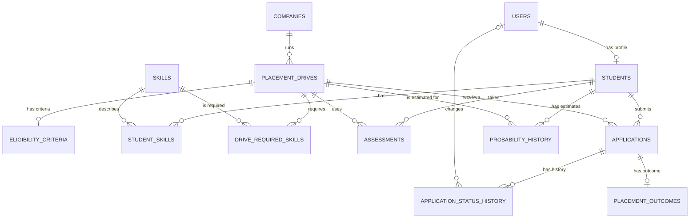

# CampusPath — Smart Campus Placement Management System

CampusPath is a Java desktop application for managing campus placement workflows. It uses Java 25, Swing/FlatLaf, PostgreSQL and JDBC. Students can manage profiles and skills, review drives and eligibility, check readiness and historical estimates, apply and track status. Administrators can manage students, companies, drives, skills and assessments, review applications, record outcomes, and export reports.

> **Development status:** The configured local PostgreSQL 18.6 server at `127.0.0.1:5432` was inspected as `postgres`. The selected `campuspath_db` was empty (no application tables or routines), so—after explicit approval—the guarded initializer created the 13-table schema and migration baseline. A repeat initialization was a no-op. The validator and read-only integration test confirmed all 13 tables and required primary/foreign keys, constraints, equivalent index definitions, trigger functions, and enabled safeguard triggers. `mvn -B clean test` passed 66 tests (0 failures, 0 errors, 0 skipped); its PostgreSQL registration/login test removed its uniquely generated account/profile, and its safeguard test rolled back all fixtures. `mvn -B compile` succeeded. The debugger reported startup, but no persistent Java window/session was observable afterward, so GUI navigation is not claimed as verified. No administrator account existed; admin workflows require one provisioned through `bootstrap-admin`. Estimator accuracy is not statistically validated; synthetic records are not real placement evidence.

## Problem statement

Placement information is often distributed across spreadsheets and separate tools. That makes student profile maintenance, application tracking, and reporting difficult to keep consistent. CampusPath is intended to bring these workflows together in one desktop application backed by PostgreSQL.

## Objectives

- Keep student profile and current skill information in a relational database.
- Provide role-appropriate student and administrator workflows.
- Track drives, eligibility, applications, and outcomes as the project grows.
- Present reports with clear provenance and avoid confusing synthetic examples with real placement results.

## Current features

- Java 25 Maven project with PostgreSQL JDBC, Swing, FlatLaf, and JUnit.
- BCrypt-backed account authentication and atomic student account/profile registration.
- Student profile and authoritative `student_skills` management through role-aware services.
- Input checks for department allow-lists, academic score percentage, attendance, backlogs, and skill proficiency.
- Administrator-only company and draft-drive management, criteria/required-skill configuration, publication, and closure.
- Eligibility evaluation with specific missing-data and rejection reasons.
- Readiness scoring with the approved 20% academics, 20% aptitude, 25% coding, 20% technical skills, and 15% communication weights. Assessment scores are normalized to 0–100; missing required assessment categories produce an incomplete result.
- Historical selection estimates from verified real outcomes for the same company, job role, and employment type; fewer than 30 comparable outcomes produces the approved insufficient-data message. Estimates use Laplace smoothing and are not guarantees.
- Application submission, role-authorized status transitions, append-only status history, and atomic final outcome recording.
- Administrator dashboard and report queries for stored counts, student/application search, and placement outcome statistics.
- Administrator analytics charts for department outcomes, application status, monthly verified placements, company hiring, package bands, readiness components, and readiness-score distribution. Outcome charts use verified real outcomes; readiness/status charts use captured application-time snapshots and exclude synthetic sample snapshots.
- Student overview cards for profile completion, eligible drives, application count, and readiness, plus current readiness-component breakdown for a published drive, recent application activity, and published drives.
- CSV export for application results and placement statistics.
- Student registration and login, BCrypt password hashing, role-specific dashboards, and logout. The sign-in screen uses a responsive split layout with a gradient campus-placement brand panel, show/hide password control, animated Sign In button, and an email-only remember-me preference (passwords are never remembered).
- Light FlatLaf workspace with a deep-navy sidebar, electric-blue active navigation, shared top bar and account/role display, styled forms/tables, responsive dashboard cards, and background `SwingWorker` operations for database-backed screens.
- Immutable application-time JSONB snapshots of the academic profile, `student_skills` evidence, drive-required skills, assessment inputs, and readiness model inputs.
- Secure first-administrator provisioning through a terminal-only bootstrap command that prompts without echoing the password.
- Placement statistics default to verified real outcomes. Synthetic outcomes can be included explicitly and are labelled by source.

## Remaining work

- Launch the Swing UI and exercise its screens against this database; the schema and database-backed registration/login are covered separately, but a full GUI navigation session is not claimed as tested.
- Provision an administrator through the documented terminal-only `bootstrap-admin` flow before attempting administrator login and workflows. No insecure default administrator is created.
- Exercise analytics on representative populated records and evaluate estimator accuracy before using estimates for decisions. The initialized database currently has no placement records.
- Run full safeguard behavior tests against a dedicated disposable database before production use.

## Technology stack

- Java 25
- Maven
- PostgreSQL 15+ (the schema uses features supported from PostgreSQL 12)
- JDBC and PostgreSQL JDBC driver
- jBCrypt for password hashing
- Jackson for JSONB estimator snapshots
- Java Swing
- FlatLaf
- JUnit 5

## Architecture

```text
Swing GUI
  ├── Student screens ──> role-aware placement services ──> DAO interfaces
  └── Administrator screens ──> management/report services ──> DAO interfaces
                                                          └── JDBC ──> PostgreSQL
```

The flow is GUI → role-aware service → DAO interface → PostgreSQL JDBC implementation. SQL is kept in DAO classes, not event handlers. Database operations run in `SwingWorker` tasks so the interface remains responsive. All DAOs and services obtain connections through `DatabaseConnection`, which loads centralized configuration from environment variables or the optional user-local properties file.

### Package structure

```text
com.campuspath
├── dao             # Persistence contracts
├── dao.impl        # PostgreSQL JDBC implementations
├── enums           # Database-mapped domain enums
├── exception       # Domain-level errors
├── gui             # Swing frames, panels, theme, and navigation
├── model           # User, profile, drive, application, and history models
├── service         # Authentication and placement business rules
└── util            # JDBC connection setup
```

### Project structure

```text
CampusPath/
├── database/
│   ├── migrations/
│   ├── schema.sql
│   ├── sample_data.sql
│   └── README.md
├── src/
│   ├── main/java/com/campuspath/
│   │   ├── dao/ and dao/impl/
│   │   ├── enums/
│   │   ├── exception/
│   │   ├── gui/
│   │   ├── model/
│   │   ├── service/
│   │   ├── util/
│   │   └── Main.java
│   ├── main/resources/
│   └── test/java/com/campuspath/
├── .gitignore
├── pom.xml
└── README.md
```

### OOP concepts currently used

- **Encapsulation:** Models keep fields private and validate values in constructors or update methods.
- **Abstraction:** DAO interfaces define persistence contracts; services depend on them instead of embedding SQL in GUI code.
- **Inheritance and polymorphism:** `Student`, `PlacementAdmin`, and the account projection extend abstract `User`, sharing the identity and role contract while retaining role-specific model behavior.

## Database ER diagram

The approved database design contains 13 tables. The current ER diagram shows the principal foreign-key relationships; junction-table composite keys are noted below.



`student_skills` has composite primary key `(student_id, skill_id)`. `drive_required_skills` has composite primary key `(drive_id, skill_id)`. `applications` is unique on `(student_id, drive_id)`. See [database/schema.sql](./database/schema.sql) for the complete definitions.

## Database setup

Use PostgreSQL 15 or later. Create `campuspath_db` only if it does not already exist. Initialize the schema through CampusPath's guarded migration runner; it refuses to initialize a non-empty, untracked schema and never drops or overwrites existing objects.

The commands below are for first-time setup on a newly created, empty database only. Do not rerun `schema.sql` against an initialized database.

PowerShell examples from the project root:

```powershell
# Only if campuspath_db does not already exist:
psql -U postgres -d postgres -c "CREATE DATABASE campuspath_db;"

# Configure the external database.properties file or environment variables,
# then run this only for the confirmed-empty database:
mvn -B exec:java '-Dexec.args=initialize-empty-database'
```

Do not run `schema.sql` or the sample-data script against an existing database. Sample data is synthetic, uses inactive accounts with unusable password placeholders, and intentionally creates no placement outcomes or probability estimates. It is not real placement evidence. See [database/README.md](./database/README.md) for schema and safeguards details.

### Configure and verify the Java database connection

The initializer applies the existing `database/schema.sql` transactionally only after confirming the approved database is empty. It records a checksum-based baseline in the separate `campuspath_meta.schema_migrations` schema, outside the 13 application tables. Re-running the initializer verifies the recorded schema and is a no-op; it refuses to overwrite a partial or conflicting schema.

If the database already contains tables but lacks the migration baseline, do not apply `database/migrations/001_application_snapshot.sql` or rerun `schema.sql` automatically. Inspect its actual catalog and data first, then prepare a targeted migration only for confirmed missing structures.

`DatabaseConnection` resolves each setting independently: a nonblank environment variable wins, and any missing value falls back to the local file. By default, the file is `%APPDATA%\CampusPath\database.properties`, shared by VS Code, other IDEs, and Maven for the current Windows user. The first-run database setup window asks for the PostgreSQL host, port, database name, username, and password, tests the connection, and then saves the file with a current-user-only Windows ACL. Passwords are never displayed or logged. A **Database settings** link on the login screen lets you update the connection later.

At startup, CampusPath checks the connection and discovers the schema containing the approved application tables. It verifies all required columns, primary/foreign keys, constraints, valid indexes, trigger functions, and enabled safeguard triggers before opening login. Startup verification is read-only and does not apply migrations or modify records. If application tables are split across schemas, startup reports that conflict rather than silently choosing one.

The tracked [config/database.properties.example](./config/database.properties.example) is a placeholder template, not a credential file. The recommended setup is to run the application and enter the values in its first-run setup window. To manage settings outside the application, create `%APPDATA%\CampusPath\database.properties` or set `CAMPUSPATH_CONFIG_FILE` to an external local file, then add:

```properties
CAMPUSPATH_DB_URL=jdbc:postgresql://localhost:5432/campuspath_db
CAMPUSPATH_DB_USER=YOUR_LOCAL_POSTGRES_USERNAME
CAMPUSPATH_DB_PASSWORD=YOUR_LOCAL_POSTGRES_PASSWORD
```

Keep the file private to your Windows account. The application does not print the password. Environment variables `CAMPUSPATH_DB_URL`, `CAMPUSPATH_DB_USER`, and `CAMPUSPATH_DB_PASSWORD` take priority over file values. For example, to launch from the same PowerShell session with environment configuration:

```powershell
$env:CAMPUSPATH_DB_URL = "jdbc:postgresql://localhost:5432/campuspath_db"
$env:CAMPUSPATH_DB_USER = "YOUR_LOCAL_POSTGRES_USERNAME"
$secure = Read-Host "PostgreSQL password" -AsSecureString
$env:CAMPUSPATH_DB_PASSWORD = [System.Net.NetworkCredential]::new("", $secure).Password
mvn -B exec:java
```

In VS Code, open the CampusPath folder and run `mvn -B exec:java` in its integrated terminal, or start `com.campuspath.Main` with the Java extension. Both use the same `%APPDATA%\CampusPath\database.properties` file automatically. If you set an environment variable in Windows or VS Code, restart the IDE so its Java process inherits the updated value.

Run all unit tests:

```powershell
mvn -B clean test
```

The suite includes PostgreSQL schema, registration/login, and safeguard integration tests when database configuration is available. Registration creates a random test-only student and removes only that account/profile; safeguard fixtures are enclosed in a transaction and rolled back. No pre-existing records are deleted. For production safety, safeguard tests should still be run against a dedicated disposable database.

Run the configuration tests without a live database:

```powershell
mvn -B -Dtest=DatabaseConfigurationTest test
```

Run only the PostgreSQL connection test. It uses either configuration source and skips only when required settings are absent from both:

```powershell
mvn -B -Dtest=DatabaseConnectionTest test
```

The connection test executes `SELECT 1` and verifies that the connected database is named `campuspath_db`. If required settings are absent or blank in both environment variables and the local properties file, JUnit marks the test skipped with the missing setting names; it does not treat an unconfigured connection as a successful database test.

Common connection errors:

- **Connection refused or timeout:** Confirm the PostgreSQL service is running and that the configured host and port are reachable.
- **Database does not exist:** Confirm `campuspath_db` exists and the URL ends with `/campuspath_db`. The application will not create the database or rerun schema scripts.
- **Authentication failed:** Re-enter the PostgreSQL username and password and verify the role can connect to `campuspath_db`. The application does not print the password or raw driver error details.
- **Missing configuration:** Start CampusPath to open the setup window, or set the three `CAMPUSPATH_DB_*` environment variables / create `%APPDATA%\CampusPath\database.properties`; environment variables override the file.
- **Wrong custom config-file path:** Check `CAMPUSPATH_CONFIG_FILE` and confirm the file is readable.
- **JDBC driver not found:** Run Maven from the project root so it can resolve the PostgreSQL JDBC dependency from `pom.xml`.

### Database safeguards

The current `database/schema.sql` implements these safeguards with PostgreSQL triggers and constraints:

- **Application submission:** A new application is accepted only for a published drive, after `opens_at` if it is set, at or before the application deadline, and before `closes_at` if it is set. Draft, closed, cancelled, not-yet-open, and expired drives reject submissions. After submission, the application’s student, drive, and original submission time cannot be changed. A unique `(student_id, drive_id)` constraint prevents duplicate applications.
- **Application-time snapshot:** Each new application stores an immutable JSONB object in `applications.application_snapshot`. It is generated inside the same repeatable-read submission transaction from the profile, current `student_skills` proficiency evidence, drive-required skills, drive-specific assessments, readiness weights/model version, and readiness result (or missing-input list). Historical rows migrated from an older schema are explicitly marked `unavailable_pre_migration`; no historical values are invented. The synthetic seed snapshot is labelled `synthetic_sample`.
- **Status transitions:** New applications must start as `submitted`. The allowed transitions are `submitted` to `under_review` or `withdrawn`, and `under_review` to `selected`, `rejected`, or `withdrawn`. `selected`, `rejected`, and `withdrawn` are terminal. Initial status and each actual status change are appended to `application_status_history`.
- **Published criteria:** Create drives as drafts and configure eligibility criteria and required skills before publication. Once `published_at` is set, those rows cannot be inserted, updated, or deleted. A criteria or required-skill row’s `drive_id` cannot be changed, even while the drive is a draft.
- **Historical records:** `assessments`, `application_status_history`, `placement_outcomes`, and `probability_history` reject `UPDATE`, `DELETE`, and `TRUNCATE` through triggers. Outcomes are unique per application and must match its final `selected` or `rejected` status; a real outcome requires verification. These triggers are safeguards against ordinary application mistakes, not against a database owner or superuser who can disable them or alter the schema.
- **Status-history actor:** The application may set `campuspath.user_id` transaction-locally after authenticating the actor. Blank or unset context records a `NULL` actor; non-numeric values are rejected, and the foreign key requires a numeric ID to identify an existing user. PostgreSQL does not independently authenticate that identity: a client using the shared application database login could supply another existing user ID. The runtime database role should not own protected tables or have `TRUNCATE` privileges.
- **Synthetic sample behavior:** `sample_data.sql` clears `campuspath.user_id` for its transaction, publishes its synthetic drive before inserting applications, and creates no placement outcomes or probability estimates. It uses conflict checks and `NOT EXISTS` filters to avoid duplicate seed rows and only changes a sample application from `submitted` to `under_review` once. It is intended to be rerunnable while missing sample applications can still be submitted; if the sample drive’s deadline has passed and an application is missing, the database correctly rejects that insertion.

## Java setup and execution

Install JDK 25, Maven 3.9+, and PostgreSQL. Start the application once and use the first-run setup window to enter and validate the existing `campuspath_db` connection. The window does not create a database or change the schema.

Create the first active administrator once from a real terminal after applying the schema. The command prompts for email and password; password input is hidden, BCrypt-hashed, and never passed as a command-line argument. It refuses to run if an active administrator already exists. If synthetic sample data created its inactive administrator placeholder, the command replaces that placeholder with the entered administrator account:

```powershell
mvn -B exec:java '-Dexec.args=bootstrap-admin'
```

If running Maven does not provide a Java console, use an ordinary Windows Terminal/PowerShell window rather than redirecting stdin or entering a password in a command. Student accounts can be created from the sign-in screen; department choices are checked against the application allow-list.

From Windows PowerShell in the CampusPath project folder, build, test, and launch the GUI:

```powershell
mvn -B clean test
mvn -B compile
mvn -B exec:java
```

The same commands work in the VS Code integrated terminal after opening the CampusPath folder. `Main` installs FlatLaf, verifies the configured PostgreSQL connection and approved schema read-only, then opens the sign-in screen. It shows the student or administrator workspace only after `AuthenticationService` validates the account. If configuration is missing, the setup window appears instead.

## Screenshots

Screenshots are not included yet. After safely exercising the application with local test accounts and PostgreSQL data, capture genuine screenshots of:

- The sign-in screen and student registration form.
- Student dashboard and profile/skills.
- Published drive list with eligibility reasons and drive details.
- Application status/history and the insufficient-history estimate message.
- Admin overview, drive criteria, application/outcome review, and reports.

Do not use mock screens as evidence of working database functionality, and redact any personal information.

## Testing

Run the unit test suite:

```powershell
mvn clean test
```

JUnit tests cover database configuration source precedence, wizard configuration validation and secure file ACLs, schema-verification report handling, safe connection-error messages, authentication and password hashing, authorization checks, profile/skill service rules, company/drive service access, eligibility explanations, readiness weights and missing assessments, application-time snapshot serialization, estimator thresholds/smoothing/provenance, application submission/status/outcome flows, report calculations/CSV formatting, chart rendering, and Swing navigation/logout. Service tests use fake DAOs. The latest `mvn -B clean test` run reported 58 tests, 0 failures, 0 errors, and 1 skipped (the live PostgreSQL connection test, because configuration was absent). Passing unit tests must not be interpreted as live PostgreSQL integration, verification of the new analytics SQL or database schema, SQL-trigger verification, transaction rollback testing against PostgreSQL, end-to-end Swing testing, or statistical validation.

## Selection probability methodology

The estimator calculates a readiness score and reports it separately from a historical selection estimate. It uses only verified, real selected/rejected outcomes and excludes pending, withdrawn, incomplete, unverified, and synthetic records. Comparable records have the same company, case-insensitive job role, and employment type. At least 30 are required before a numeric estimate is produced. The estimate applies Laplace smoothing:

```text
Estimated probability = ((selected count + 1) / (sample size + 2)) × 100
```

The numerical probability is a smoothed historical cohort rate; readiness is stored as a separate input and is not used to adjust that rate. New applications preserve application-time academic, skill and assessment evidence so future cohort analyses can be reproduced; the current estimator still uses the established company/role/employment cohort and does not condition probability on readiness. Pre-migration applications lack recoverable snapshots. The probability is an estimate, not a guarantee of selection, and has not been validated for statistical accuracy. `probability_history` stores the model version, cohort definition, readiness weights and inputs, sample counts, calculation time, and real-data provenance.

## Limitations and future enhancements

- Add integration tests using a dedicated test database.
- Validate the seven analytics queries against a populated database. The package chart bins a drive's maximum advertised INR package range for verified selected outcomes; it does not represent a student's accepted salary, which is not stored in the approved schema.
- Eligibility supports the criteria represented in the approved schema (academic percentage, attendance, department, graduation year, backlogs, and required skills). Per-drive degree eligibility is not currently representable because `eligibility_criteria` has no degree field; adding it requires a separately approved schema change.
- Add provenance for synthetic application/profile records if reports must separate those from real records; the current schema marks assessment and outcome provenance but not every entity.
- Before production use, configure least-privilege database roles and authenticate users in the application. Trigger-based safeguards do not prevent a table owner or superuser from disabling triggers, and `campuspath.user_id` is caller-supplied audit context rather than independently authenticated identity.
- Validate the historical estimator on representative real data before using its estimates in decisions.
- Run and visually verify all GUI workflows against a local test database, then add genuine screenshots.
- Plan support for multiple offers and employment milestones as a separately reviewed database enhancement.

## Project explanation for interviews

CampusPath is a Java Swing placement-management desktop application backed by PostgreSQL. Students maintain profiles, review drives, check eligibility and readiness, apply, and track status; administrators manage drives and review applications and outcomes. The application uses role-aware services between the UI and JDBC DAOs, while database constraints and triggers protect important historical and workflow rules. Historical selection estimates use only verified real outcomes and are kept separate from readiness scores.

## Synthetic data disclaimer

Every row in `database/sample_data.sql` is synthetic test data. Synthetic rows must never be presented as real placement outcomes, used to train or validate a production estimator, or included in real placement statistics. The report DAO defaults to verified real outcomes; any synthetic-inclusive outcome report includes a `source_type` label.

## Contributing

Contributions should include focused tests, preserve the approved 13-table database design unless a change is reviewed, and clearly distinguish implemented behavior from planned work. Do not commit credentials, real student personal information, or unlabelled sample statistics. No contribution workflow is configured yet.

## License

No license has been selected. Until one is approved and added, do not assume the project is licensed for redistribution or reuse.

## GitHub preparation

This workspace has not been initialized as a Git repository, and no remote is configured. After reviewing files and choosing a license, initialize and commit locally:

```powershell
git init
git branch -M main
git add .gitignore README.md pom.xml database src
git status --short
git diff --cached
git commit -m "Prepare CampusPath desktop application"
```

Create a GitHub repository named `CampusPath-Smart-Campus-Placement-Management-System`, then add its URL and push:

```powershell
git remote add origin https://github.com/<YOUR-ACCOUNT>/CampusPath-Smart-Campus-Placement-Management-System.git
git push -u origin main
```

These are instructions only; no repository has been initialized or pushed by this project setup.
